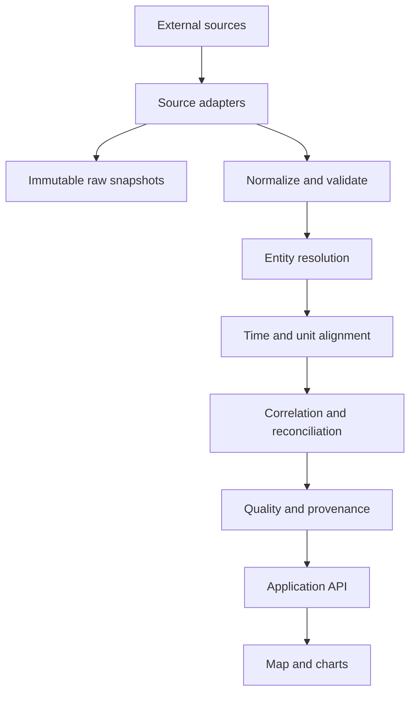

> **Infrastructure update — 18 September 2026:** The app now includes a separately licensed OpenStreetMap Grid view with 3,448 mapped objects (line/cable sections and substations), voltage filtering, search, provenance and download. This is geographic infrastructure, not validated electrical topology or live line loading. See `DATA_ROADMAP.md` for the current NED, ENTSO-E, TenneT and regional-source plan, and `RESEARCH.md` for new evidence and reuse constraints. Earlier statements that all domestic line geometry is absent are superseded by this addition.

# Netherlands Grid Explorer

## Product plan research dossier and Codex build prompt

Prepared 17 September 2026; corrected after payload inspection on 18 September 2026.

## Evidence correction and implementation status

The initial plan below is an aspirational roadmap. Actual payload tests now take precedence. Energy-Charts v2 national generation and physical-border feeds work without keys; the first app uses them. NED load is national only. Liander transport is stale, lacks sub-grid IDs and has implausible MW magnitudes; it is quarantined. Liander annual small-consumer SJV data is imported at postcode level but is expected annual consumption, not metered actuals. RWE output is not connected. The map contains 69 historical WRI records plus two operator-reviewed additions, not a verified current fleet. Plant output remains unknown; city/province demand is illustrative only. Freshness is separate from method. The app uses D1 rather than PostGIS for this first deployment. Browser preview was unavailable, so visual/interaction QA remains outstanding. See the app Methodology and Data sources views, and docs/RESEARCH.md in the project for evidence and unmet milestones.


## 1 Executive decision

Build a provenance-first web application that explains the Dutch electricity system at several spatial and temporal levels: national balance, cross-border exchange, generation assets, transmission infrastructure, DSO sub-grids, provinces, municipalities and cities.

The application must never imply that all displayed flows are measured or real time. Every value must carry a method, source timestamp, ingestion timestamp, resolution, latency, revision status and confidence. The product should make uncertainty visible rather than hide it.

The first release should be a working vertical slice with an explicit list of unmet coverage goals. It should combine live or recent national data, cross-border flows, a curated asset registry, RWE plant output where technically and legally usable, modelled offshore wind from NED, Liander sub-grid actuals where identifiable, and estimated city demand. Other DSOs and producers should plug into the same adapter framework as sources are validated.

## 2 Product promise

The app should answer five questions:

1. How is the Netherlands producing and consuming electricity now?
2. Where are the major generators, and how much is each contributing?
3. Which borders are importing or exporting power?
4. Which regions or cities are net consumers or producers?
5. Which numbers are measured, modelled, inferred or allocated, and how trustworthy and fresh are they?

It is an educational and analytical public-data product. It is not an operational control system, outage authority, trading terminal, or exact power-flow model.

## 3 Core user experiences

### 3.1 Live overview

- National generation, load, imports, exports, storage if available and reconciliation residual.
- Generation mix by technology.
- Source freshness and system-wide data-quality status.
- Time scrubber with a consistent effective timestamp.

### 3.2 Generation map

- Markers for utility-scale plants, offshore wind farms, major onshore wind, waste-to-energy, hydro, biomass and large solar assets.
- Marker size by capacity or current output; color by technology; shape or badge by measurement method.
- Asset detail: owner, operator, technology, capacity, current output, utilization, source, effective time, delay and method.
- Regional aggregate layers for generation that cannot be assigned to individual assets.

### 3.3 Grid and exchange map

- Transmission lines, substations and interconnectors where licensing and data quality permit.
- Animated border arrows for NL to or from BE, DE, GB, NO and DK, based on physical-flow data.
- Do not animate individual domestic line flows unless a measured source exists. Otherwise label a separate scenario or model layer explicitly.

### 3.4 Demand map

- Province and municipality choropleths for estimated demand and net demand.
- City cards showing estimated gross demand, estimated local generation, net demand, quality and updated time.
- Industrial or other large-load adjustments shown separately from small-consumer estimates.

### 3.5 Historical explorer

- Select time, location, technology, operator and method.
- Plot generation, load, flows and residuals.
- Explain source revisions and gaps instead of silently interpolating them.

## 4 Non negotiable data semantics

Use these method classes everywhere:

| Class | Meaning | Example |
|---|---|---|
| Measured | Direct telemetry only when the measurement basis is verified | Candidate plant or grid meters; not yet connected |
| Modelled | Published provider model tied to a named asset or region | NED individual offshore-wind-farm output |
| Inferred | Derived from other observations and constraints | plant output inferred from availability and category totals |
| Allocated | A measured aggregate distributed spatially by weights | regional load allocated to municipalities |
| Static | Capacity, geometry, ownership or other registry fact | installed MW, coordinates |
| Stale status | Freshness flag, independent of estimation method, beyond its source-specific threshold | last good value after feed failure |

Never relabel modelled, inferred or allocated data as measured. A single number may have a static capacity source and a separate dynamic-output source.

Every observation should include:

```text
subject_id
metric
value
unit
effective_start
effective_end
published_at
ingested_at
source_id
source_record_id
method_class
spatial_scope
resolution_seconds
quality_flags
revision
```

Store energy and power separately. NED `capacity` is average power during an interval and is returned in kW; `volume` is energy in kWh. Normalize display power to MW, but preserve raw values and units.

## 5 Source plan

This matrix is a research backlog, not a claim that every feed is immediately reusable. Each adapter must pass endpoint, terms, attribution, cadence and redistribution review before production use.

| Priority | Source | Expected contribution | Access and known facts | Validation required |
|---:|---|---|---|---|
| P0 | NED API | National load; national/provincial renewable generation; technology mix; individual offshore-wind models; forecasts | REST/OpenAPI; account API key; JSON/CSV and other formats; documented limit 200 requests per 5 minutes; 10-min, 15-min and hourly granularities | Confirm dataset-specific availability, latency, licensing, caching and redistribution terms |
| P0 | ENTSO-E Transparency Platform | Actual load, production by type, physical cross-border flows, scheduled exchanges, historical unit generation | Security token required; XML API; bidding-zone identifiers; unit output may be delayed | Confirm current API rules, document types, rate limits and publication delays |
| P0 | Liander open data | Sub-grid actual transport and forecasts; small-consumer annual use; distributed generation; infrastructure; profiles | Actual and forecast sub-grid transport published in quarter-hours for previous 7 days; ArcGIS/WFS; open datasets | Download samples; identify sub-grid keys, sign conventions, geography, timestamps, update behavior and license |
| P0 | Static generation asset registry | Names, aliases, technology, capacity, coordinates, owners/operators and source IDs | Curated from authoritative operator and government sources | Establish inclusion threshold, ownership history and review workflow |
| P1 | RWE Production Data | Measured output for individually named RWE Dutch assets | Public site reports 15-minute plant generation with roughly one-hour delay | Discover supported machine endpoint without bypassing controls; confirm reuse terms, stability and identifiers |
| P1 | TenneT developer APIs | Imbalance, balancing activation, metered injections, border capacity and system context | Public developer portal; APIs vary in authentication and semantics | Inventory exact endpoints, scopes, rate limits, data definitions and license |
| P1 | Enexis open data | Small-connection consumption and decentralized generation; station and congestion information | Public downloads, not assumed live | Inspect schemas, geography, cadence and reuse terms |
| P1 | Stedin open data | Small-consumer use and return; infrastructure and regional context | Public downloads and map data | Inspect schemas, geography, cadence and reuse terms |
| P1 | CBS and PDOK | Municipal, district, neighbourhood and postcode boundaries; demographic and sector weights | OData and geoservices | Pin dataset editions and boundary identifiers; handle municipal changes |
| P1 | KNMI | Weather observations and forecasts for solar, wind, heat and demand models | API/key requirements vary by product | Choose variables, stations or grids, terms and caching policy |
| P2 | EEX and operator REMIT pages | Availability and outage events for large units | Event data, not actual continuous output | Access and redistribution rights; link events to canonical assets |
| P2 | EPZ and other operator status pages | Plant status and operator-confirmed events | Often web pages or news rather than APIs | Use only stable, permitted extraction; record event confidence |
| P2 | OpenStreetMap or operator topology | Supplemental grid geometry and points | ODbL obligations if OSM is used | Decide whether attribution/share-alike obligations fit the product |
| P2 | Regional and municipal open data | Large projects, charging, heat pumps, solar registries and local context | Highly heterogeneous | Add only through isolated adapters with documented coverage |

### 5.1 Verified details worth encoding now

- NED documents `https://api.ned.nl/v1/utilizations`, account-bound `X-AUTH-TOKEN`, point/type/granularity/classification/activity parameters, and UTC returns. It exposes activities for providing, consuming, import, export, storage in and storage out. Its documented points include all provinces and named offshore wind farms. Historical records may be revised; `lastupdate` must therefore be stored and backfills must be idempotent.
- Liander states that its actual and forecast electricity transports are provided per sub-grid, quarter by quarter in MW, with files for Flevoland, Friesland, Zuid-Holland, Noord-Holland and Gelderland covering the previous seven days. This is the highest-value early feasibility test for regional load.
- Liander small-consumer consumption is postcode-aggregated and annual. Its distributed small-generation dataset is at CBS-neighbourhood level and suppresses small counts. These are weighting inputs, not live demand.
- Liander also publishes large-consumer load profiles by SBI sector based on 2023 quarter-hour measurements. These can improve city estimates without exposing individual businesses.
- LianderPower contains anonymized five-minute historical grid series for 2013 to 2024 under CC BY 4.0, but removes exact topology and identifiers. It is useful for model development and testing, not direct geographic live mapping.

## 6 Geographic model

Create stable canonical entities and separate them from observations.

```text
Country
  Province
    Municipality
      District
        Neighbourhood

GridArea
  TSO_DSO_Boundary
    Subgrid
      Station
        Feeder if public

EnergyAsset
  GenerationUnit or Plant
  WindFarm
  StorageAsset
  Interconnector
  LargeLoad when publishable
```

Relationships are many-to-many and time-versioned. A municipality may span several sub-grids; a sub-grid may serve several municipalities; an asset can change owner; municipal boundaries change. Use weighted spatial crosswalk tables with `valid_from`, `valid_to`, method and confidence.

Do not equate a DSO service area, grid area, province or municipality.

## 7 City and regional demand model

### 7.1 Definition

For a city or municipality at time `t`:

```text
gross_demand = small_connection_demand
             + large_connection_demand
             + transport_and_infrastructure_load
             + model_residual_allocation

net_grid_demand = gross_demand - behind_the_meter_generation
```

Public sources often observe net transport, while users may interpret demand as gross consumption. Show both only when the distinction can be supported; otherwise label the metric precisely.

### 7.2 Estimation ladder

1. Start with measured sub-grid actual transport where geography and sign are understood.
2. Build sub-grid to municipality allocation weights using postcode small-consumer annual use, CBS boundaries, DSO topology and published generation capacity.
3. Apply time-varying profiles by customer mix, weekday, hour, season and weather.
4. Add separate large-consumer estimates using sector profiles and public facility/industrial information, without identifying private customers unless already lawfully public.
5. Subtract or separately report estimated behind-the-meter solar and other local production.
6. Reconcile municipality estimates back to each measured sub-grid and then to national load.
7. Publish prediction intervals or confidence bands and the allocation share based on direct measurements.

### 7.3 Reconciliation

At each common interval, compute:

```text
generation + imports - exports + storage_discharge - storage_charge
- load = losses + timing_difference + coverage_error
```

Never force the residual to zero invisibly. Store raw series, aligned series and adjustment terms. UI should show the residual and explain likely causes such as timestamp misalignment, net/gross definitions, missing assets, model revisions and network losses.

## 8 Technical architecture

### 8.1 Recommended stack

- TypeScript monorepo with a React/Next.js frontend.
- MapLibre GL JS for the map and deck.gl only if high-volume layers require it.
- PostgreSQL with PostGIS and TimescaleDB if operationally available; otherwise PostgreSQL partitioned time-series tables.
- Object storage for immutable raw responses and source snapshots.
- Worker or job service for adapters and backfills.
- Redis only if needed for queues, locks or hot cache; avoid it in the first local vertical slice.
- OpenAPI-generated or Zod-validated internal contracts.
- Docker Compose for reproducible local development.

The final deployment target can change, but adapters, domain logic and database migrations must not depend on a single host.

### 8.2 Pipeline



### 8.3 Adapter contract

Each source adapter should implement:

```ts
interface SourceAdapter {
  sourceId: string;
  discover(): Promise<SourceCapabilities>;
  fetchWindow(window: TimeWindow): Promise<RawArtifact[]>;
  normalize(raw: RawArtifact): Promise<NormalizedRecord[]>;
  health(): Promise<SourceHealth>;
}
```

Adapters must support deterministic replay from saved raw artifacts, bounded retries, conditional requests where supported, backoff, rate-limit accounting, schema-drift alerts and fixtures that contain no secrets.

### 8.4 Core tables

- `source` and `source_license`
- `raw_artifact`
- `entity`, `entity_alias`, `entity_relation`
- `asset`, `organization`, `asset_ownership`
- `geography`, `grid_area`, `spatial_crosswalk`
- `metric_definition`
- `observation_raw`, `observation_normalized`, `observation_derived`
- `derivation_run`, `derivation_input`
- `quality_event`, `source_health`

Use uniqueness keys that make ingestion idempotent. Derived observations must point to all inputs and a versioned method.

## 9 API and UI contract

Minimum endpoints:

```text
GET /api/v1/system/snapshot?at=
GET /api/v1/system/balance?from=&to=&resolution=
GET /api/v1/assets?bbox=&technology=&operator=&method=
GET /api/v1/assets/{id}
GET /api/v1/assets/{id}/observations?from=&to=
GET /api/v1/flows/borders?at=
GET /api/v1/regions?level=province|municipality&at=
GET /api/v1/regions/{id}/demand?from=&to=
GET /api/v1/sources/status
GET /api/v1/provenance/{observationId}
```

Map requirements:

- Smooth pan, zoom, mobile layout and keyboard-accessible controls.
- Layer switcher for generation, demand, borders, transmission, DSO regions, congestion and data quality.
- Global time cursor; every visible layer reports the effective time it is showing.
- Legend includes unit, method, freshness and spatial meaning.
- Clicking a value exposes its provenance chain.
- Never use animation that suggests physical accuracy beyond the data.

## 10 Delivery phases

### Phase 0 Evidence and feasibility spikes

Timebox each spike and save sample payloads, schemas and a written go/no-go result.

1. Liander sub-grid CSV: download, parse, identify names/IDs, directions, interval timestamps, actual versus forecast columns, geographic join and update behavior.
2. NED: create a key manually, inspect OpenAPI, query national load, generation mix and two offshore farms, verify units, latency and revisions.
3. ENTSO-E: obtain token manually, test NL load, production by type and each border; document domain IDs and daylight-saving behavior.
4. RWE: inspect normal public network requests and terms; do not bypass bot controls or authentication. If no stable permitted endpoint exists, defer the adapter and use fixtures.
5. Asset registry: produce the first 50 to 100 high-impact operating assets with authoritative coordinates, capacity, technology, owners/operators and source aliases.
6. Licensing: create a source-by-source attribution and redistribution decision record.

Exit criterion: at least one legal, repeatable dynamic feed for national balance, borders, assets or asset models, and regional load; otherwise revise MVP scope.

### Phase 1 Walking skeleton

- Monorepo, migrations, Docker Compose, CI and environment template.
- Adapter framework with fixture mode.
- Energy-Charts adapter and Liander annual-baseline parser; quarantine unresolved transport. Credentialed adapters follow validation.
- Canonical asset/geography registry seed.
- Snapshot API, provenance API and source-health page.
- Map with assets, national balance, province/municipality geometry and time cursor.
- Golden-fixture tests, unit normalization tests and DST tests.

### Phase 2 Correlation and demand

- Sub-grid to municipality crosswalk.
- Municipality demand model with explicit uncertainty.
- National and regional reconciliation jobs.
- Historical charts, net-position choropleth and residual diagnostics.
- Backfill and revision handling.

### Phase 3 Coverage expansion

- RWE if approved, TenneT, Enexis, Stedin and REMIT adapters.
- More complete generation and storage registry.
- Operator status events and outage overlays.
- Congestion/capacity layers and forecasting.

### Phase 4 Hardening

- Observability, source schema-drift alerts, adapter circuit breakers and cost controls.
- Accessibility, performance budgets, map simplification and mobile QA.
- Public methodology, attribution, privacy and data-correction workflow.
- Security review and production deployment.

## 11 MVP acceptance criteria

- A user can inspect the latest Dutch balance and see its effective timestamp.
- At least five cross-border connections show direction and MW with provenance.
- At least 50 major assets appear with verified location, technology and capacity.
- At least two distinct dynamic asset-output methods appear and are visibly differentiated, for example measured and modelled.
- At least one Liander regional/sub-grid actual series is parsed and visualized, or the feasibility report explains exactly why it cannot be geographically used.
- At least five municipalities display demand estimates that reconcile to their parent measured aggregate, with confidence metadata.
- Every dynamic value opens a provenance view.
- Stale, missing and revised data are visible states.
- The app runs fully in fixture/demo mode without credentials.
- Tests cover unit conversion, time zones and DST, sign conventions, idempotent ingestion, revisions, reconciliation and stale-data behavior.

## 12 Risks and controls

| Risk | Control |
|---|---|
| Scraping a fragile or prohibited source | Prefer documented APIs/downloads; record terms; isolate scraper-like adapters; never bypass access controls |
| False precision | Method badges, uncertainty, effective time, quality flags and explanatory copy |
| Time misalignment | UTC storage, explicit interval semantics, common alignment windows and DST tests |
| Double counting generation | Canonical entities, source priority rules and overlap tests |
| Confusing gross demand with net transport | Metric dictionary and precise UI labels |
| Municipal estimates miss industrial loads | Separate large-load component and show uncertainty |
| Source revisions change history | Immutable raw snapshots, `lastupdate`, revisioned observations and reproducible derivations |
| Credentials leak to browser or repository | Server-only secrets, `.env.example`, secret scanning and fixture mode |
| Map topology implies live domestic line flows | Static topology styling unless measured; model layers clearly separated |
| Licensing blocks redistribution | Source license register and attribution component before production ingestion |

## 13 Questions the owner must answer before production

These do not block a fixture-first build:

1. Is the initial audience public, internal research, or both?
2. Is the primary promise education, operational awareness, energy analytics or journalism?
3. What hosting budget and update cadence are acceptable?
4. Can accounts and API keys be created for NED and ENTSO-E?
5. Should municipal demand prioritize interpretability or maximum predictive accuracy?
6. Is OSM acceptable with its attribution and database-license obligations?
7. What minimum asset size defines the registry, and should industrial CHP be included?

## 14 Research sources

- [NED API guide](https://ned.nl/nl/handleiding-api) — endpoint shape, authentication, rate limit, points, types, activities, granularities, units and revision behavior.
- [NED Swagger UI](https://api.ned.nl/v1) — machine interface to inspect during the credentialed spike.
- [Liander open data](https://www.liander.nl/over-ons/open-data) — sub-grid actuals and forecasts, infrastructure services, postcode consumption, distributed generation, sector profiles and historical grid measurements.
- [TenneT developer portal](https://developer.tennet.eu/) — current API inventory and documentation.
- [ENTSO-E Transparency Platform](https://transparency.entsoe.eu/) — European system, generation, load and exchange data.
- [ENTSO-E API documentation](https://transparency.entsoe.eu/content/static_content/Static%20content/web%20api/Guide.html) — API parameters and document types; verify the current accessible URL during implementation.
- [RWE Production Data Netherlands](https://www.rwe-production-data.com/en/list/all/NL/) — operator-published Dutch asset output and metadata; endpoint and reuse validation still required.
- [Enexis open data](https://www.enexis.nl/over-ons/waar-staan-wij-voor/open-data) — public distribution data catalogue.
- [Stedin open data](https://www.stedin.net/zakelijk/open-data) — public distribution datasets and infrastructure information.
- [PDOK](https://www.pdok.nl/) and [CBS open data](https://www.cbs.nl/en-gb/our-services/open-data) — Dutch administrative geography and statistics.

## 15 Codex build prompt

Copy everything below into a new Codex task together with this file.

---

You are building the first working version of **Netherlands Grid Explorer**, a provenance-first web application for visualizing the Dutch electricity system. Read the attached build brief completely before acting. Treat it as the product and architecture specification, but verify repository reality and current official API documentation before coding.

Your goal is to deliver a tested, locally runnable vertical slice that works without secrets in fixture mode and can use real feeds when the user supplies credentials.

### Required outcome

Build a TypeScript application with:

- an interactive Netherlands map;
- a national balance summary;
- major generation-asset markers;
- cross-border flow visualization;
- province and municipality demand layers;
- a global time cursor;
- visible measured, modelled, inferred, allocated and stale states;
- a provenance drawer for every dynamic value;
- a source-health view;
- fixture/demo mode and documented real-source configuration.

### First actions

1. Inspect the repository and any `AGENTS.md` files. Preserve unrelated user changes.
2. Write a short implementation plan tied to the brief's Phase 0 and Phase 1 acceptance criteria.
3. Run bounded feasibility spikes before committing to source implementations:
   - parse a current Liander sub-grid transport CSV and report its schema, timestamps, sign conventions, actual/forecast fields and geographic identifiers;
   - inspect NED OpenAPI and implement it only if a key is available; otherwise create a contract-compatible fixture adapter;
   - implement ENTSO-E only if a token is available; otherwise use realistic saved fixtures and document exact setup;
   - inspect RWE only through ordinary public requests and published terms; do not bypass controls. Defer it if no stable permitted endpoint is available.
4. Create a source-license and attribution register before enabling production ingestion.

### Implementation constraints

- Use Next.js/React and TypeScript unless the existing repository dictates otherwise.
- Use MapLibre GL JS for mapping.
- Use PostgreSQL/PostGIS for persistent canonical and observation data if the repo already supports services; otherwise provide a clean local adapter and migrations without blocking the frontend.
- Keep source adapters independent from UI code.
- Save immutable raw source artifacts, then normalize. Derived records must retain input lineage.
- Store timestamps in UTC and explicitly model interval start/end, publication time and ingestion time.
- Preserve raw units. Convert display values through tested utilities.
- Use canonical entities and aliases to prevent duplicates across sources.
- Never expose server API keys to the browser.
- Do not make up live data. Fixture mode must be visibly labelled.
- Do not animate domestic line flows unless a measured source supports them.
- Do not call modelled or allocated values measured.
- Prefer official APIs and downloads. Do not bypass authentication, rate limits or bot protection.

### Required data model

Implement the entities and observation fields specified in sections 4, 6 and 8 of the brief. At minimum include source, license, raw artifact, asset, organization, geography, grid area, aliases, observations, derivation lineage and quality events.

### Required tests

- power versus energy unit conversion;
- UTC and Europe/Amsterdam DST boundaries;
- interval alignment;
- import/export and injection/withdrawal sign conventions;
- idempotent ingestion;
- historical revisions;
- entity alias resolution and double-count prevention;
- reconciliation residual;
- stale and missing feed behavior;
- adapter contract tests using golden fixtures;
- key UI interactions and responsive map layout.

### Deliverables

- runnable source code;
- database migrations and seed data;
- at least 50 verified or clearly fixture-labelled major assets;
- `.env.example` with no secrets;
- Docker/local development instructions;
- architecture and methodology documentation;
- source/license register;
- Phase 0 feasibility report with evidence and go/no-go decisions;
- screenshots or browser-test evidence for desktop and mobile;
- a final gap list mapped to Phase 2 and Phase 3.

### Definition of done

The app starts from a clean checkout, works in fixture mode, passes lint/typecheck/tests, and meets the MVP acceptance criteria in section 11 or explicitly documents any blocked criterion with evidence. Validate the rendered UI in a real browser. Keep the interface calm and legible; provenance and uncertainty should be understandable without reading technical documentation.

Do not stop at scaffolding. Complete the vertical slice, verify it, and report exactly which views use live data, fixtures, models or allocations.

---


## Expansion behavior
Recorded Demand is a CBS 2023 annual residential postcode choropleth. Do not imply that changing the national 15-minute timeline changes those annual values. Keep the year, unit, missingness, scope and attribution visible. The extra Liander baseline is separately labelled SJV, 2026.

Grid stations have their own searchable layer and may be overlaid on generation. Load expanded catalogues lazily and use MapLibre source/layer rendering. Keep original OSM object identities; do not infer electrical connections from proximity. The historical WRI registry remains explicitly separate from newer community mapping. The map supports zoom through level 16 for dense station locations.
